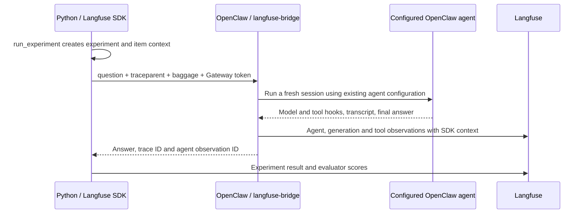

# openclaw-x-langfuse-plugin

Forward [OpenClaw](https://openclaw.ai) model-usage diagnostics to
[Langfuse](https://langfuse.com).

The plugin registers a background service that subscribes to OpenClaw's internal
diagnostics bus and reconstructs each turn as a **nested Langfuse trace**: one
root per turn (grouped by the W3C trace id OpenClaw stamps on every event), with
a child observation for every model call, tool call, and retrieval step in it.
Traces are tagged with the OpenClaw session id so a conversation's turns group
together in Langfuse's Sessions view.

Crucially, **tool calls and RAG/retrieval steps appear as their own
observations** (`tool` and `retriever` types) nested under the run — so you can
see the retrieval that fed a generation instead of the context just appearing in
the next prompt out of nowhere.

Built on the Langfuse **v5 SDK** (OpenTelemetry-based), so traces appear in
Langfuse's new observations-first ("fast") UI. The Langfuse `SpanProcessor` runs
on a dedicated, isolated OTel `TracerProvider` (`setLangfuseTracerProvider`) so
it never touches the global OpenTelemetry state OpenClaw's bundled
`diagnostics-otel` service owns.

It subscribes via the public `onInternalDiagnosticEvent` SDK export. (The
`ctx.internalDiagnostics.onEvent` capability is privileged — the runtime injects
it only for the bundled `diagnostics-otel`/`diagnostics-prometheus` services, so
third-party plugins never receive it.) The public listener delivers the
`run.*`, `model.usage`, `tool.execution.*`, `context.assembled`, and
`model.call.error` event bodies this bridge maps (minus private message content
— see below).

## Install

```bash
openclaw plugins install openclaw-x-langfuse-plugin
```

OpenClaw resolves through ClawHub first and falls back to npm. For local
development, install from a path with `--link`:

```bash
openclaw plugins install ./openclaw-x-langfuse-plugin --link
```

## Configure

Enable the plugin and provide Langfuse credentials in `openclaw.json`:

```json
{
  "plugins": {
    "allow": ["langfuse-bridge"],
    "entries": {
      "langfuse-bridge": {
        "enabled": true,
        "config": {
          "publicKey": "pk-lf-...",
          "secretKey": "sk-lf-...",
          "baseUrl": "https://cloud.langfuse.com"
        }
      }
    }
  }
}
```

Credentials may also be supplied via environment variables, which take effect
when the corresponding config field is absent:

| Config field | Environment fallback   | Default                        |
| ------------ | ---------------------- | ------------------------------ |
| `publicKey`  | `LANGFUSE_PUBLIC_KEY`  | —                              |
| `secretKey`  | `LANGFUSE_SECRET_KEY`  | —                              |
| `baseUrl`    | `LANGFUSE_BASE_URL`    | `https://cloud.langfuse.com`   |

Then restart the gateway:

```bash
openclaw gateway restart
```

If `publicKey`/`secretKey` are missing, the service logs a warning and does not
start — it never blocks the gateway.

## What gets sent

Each OpenClaw turn becomes one Langfuse trace (keyed by the shared W3C trace id),
named after the channel, with `session.id` set to the OpenClaw session id so a
conversation's turns group in the Sessions view. Under that root:

- **Turn root** (`agent`) — anchored by `run.started`/`run.completed`, with
  `outcome` and `durationMs`. Its trace-level input/output mirror the turn's
  prompt and final response. (OpenClaw's per-event span parents are inconsistent
  — `model.usage` hangs off the harness span while tools hang off the run span —
  so children are attached directly to this one root rather than reconstructing
  that internal chain.)
- **Generation** — built from `model.usage`: `model`, `usageDetails` (`input`,
  `output`, `cache_read`, `cache_write`, `total`), `costDetails.totalCost` (USD),
  timing, plus provider metadata and the turn's prompt/response text as
  input/output.
- **Tool / Retriever** — one observation per `tool.execution.*`, named after the
  tool. Retrieval/search tools (vector search, RAG, grep, web fetch, memory
  recall, …) are classified as Langfuse `retriever` observations; everything else
  is a `tool`. Carries `toolSource`, `paramsSummary`, duration, and — when
  recoverable — the tool's arguments and result as input/output.
- **Context** — `context.assembled` becomes a short span with message/prompt
  size metadata.
- **Errors** — `model.call.error` becomes an ERROR observation with the failure
  category/kind.

Message content (prompts, responses, tool arguments and results) is **not**
delivered to third-party plugins by the diagnostic bus — OpenClaw hands it
only to bundled diagnostics services on that path. The bridge recovers it best-effort from the per-session trajectory
transcript
(`<stateDir>/agents/<agentId>/sessions/<sessionId>.trajectory.jsonl`). If the
transcript is unavailable, observations are still forwarded with empty
input/output; the structure (which step ran, when, how long) is always present.

### Robustness

OpenClaw delivers `tool.execution.*` and `model.call.*` events asynchronously
(they're queued and can be dropped under heavy load), while `run.*` and
`model.usage` are synchronous — so `run.completed` reaches the bridge *before*
its own tool events, and `model.usage` arrives *after* it. The engine handles
this by soft-ending the turn root (fixing its duration) while keeping it
resolvable, so late-arriving children still attach to it, and an idle reaper
closes any observation orphaned by a dropped terminal event.

## How it works

```js
import { onInternalDiagnosticEvent } from "openclaw/plugin-sdk/diagnostic-runtime";
import { NodeTracerProvider } from "@opentelemetry/sdk-trace-node";
import { LangfuseSpanProcessor } from "@langfuse/otel";
import { startObservation, setLangfuseTracerProvider } from "@langfuse/tracing";
import { createTraceEngine } from "./tracer.js";

api.registerService({
  id: "langfuse-bridge",
  start(ctx) {
    // Isolated OTel pipeline -> never touches OpenClaw's global tracer provider.
    const provider = new NodeTracerProvider({
      spanProcessors: [new LangfuseSpanProcessor({ publicKey, secretKey, baseUrl })],
    });
    setLangfuseTracerProvider(provider);

    // The engine groups observations into one trace per turn, keyed by the W3C
    // trace id OpenClaw stamps on every event, and attaches model.usage /
    // tool.execution.* / context.assembled as children of that turn root.
    const engine = createTraceEngine({ startObservation }, { /* resolvers */ });
    const unsubscribe = onInternalDiagnosticEvent((evt) => engine.handle(evt));
    setInterval(() => engine.sweep(), 60_000).unref(); // reap orphans
  },
});
```

> Note: these events are emitted on OpenClaw's reply/delivery path (channel
> messages, webchat/TUI turns) — not on direct `openclaw agent` CLI runs, which
> use the embedded runner and don't emit them.

## SDK experiments (optional)

Enable an authenticated HTTP entrypoint to evaluate an existing OpenClaw agent
from the [Langfuse Python SDK](https://langfuse.com/docs/evaluation/experiments/experiments-via-sdk).
The SDK creates the experiment and item; this plugin continues the task's trace
and exports the agent's model/tool observations directly through its existing
Langfuse exporter.



This feature is disabled by default. It requires OpenClaw's embedded-agent
runtime, `SessionManager.inMemory`, detached sessions and model-call hooks;
use OpenClaw **2026.11.5** (the integration test target) or a compatible host.
The ordinary diagnostics bridge retains its existing host compatibility.

Add to the plugin's existing `config` and restart the Gateway:

```json
{
  "experiments": {
    "enabled": true,
    "allowedAgents": ["main"],
    "timeoutMs": 120000,
    "maxConcurrentRuns": 4
  }
}
```

The route is `POST /plugins/langfuse-bridge/experiments/run`, registered with
OpenClaw's `auth: "gateway"`. The Gateway enforces authentication and its route
scope policy. The caller needs an authorized Gateway credential; Langfuse keys
stay in the Python process and plugin configuration, never in request baggage.
Both must use the same Langfuse project. Use HTTPS outside a trusted local
network, since the request carries a Gateway credential and a question.

Run [examples/experiment.py](examples/experiment.py) with the listed environment
variables. It uses Langfuse Python SDK **5.2.0**, `run_experiment`, and public OTel
propagation APIs. In that SDK version, experiment attributes exist on the task
span but are not automatically injected into HTTP baggage; the example copies
those SDK-generated attributes before injecting the headers (excluding expected
output), then normalizes Python OTel's `+`-encoded spaces to `%20` for JS W3C
decoding. No separate trace
receiver or Python tracing service is needed.

### Request and context contract

The JSON body accepts only `question` (nonempty string) and optional `agent_id`
(default `main`). An agent must be configured and explicitly allowed above.
Each request gets a fresh, in-memory session while reusing that agent's current
configuration, workspace, tools and harness. It does not resume a channel
conversation. Its tools retain their normal permissions and may modify the
shared workspace; session isolation does not isolate tool side effects.

| Header / baggage field | Meaning |
| --- | --- |
| `traceparent` (required) | W3C trace ID and parent span generated by the SDK task |
| `langfuse.experiment.id`, `.name` (required) | Existing SDK experiment identity |
| `langfuse.experiment.item.id` (required) | Existing SDK experiment item |
| `langfuse.experiment.item.root_observation_id` (required) | SDK item root; preserved, not replaced with the plugin's agent span |
| `langfuse.experiment.metadata` | JSON object of experiment metadata |
| `langfuse.experiment.dataset.id`, `.item.version`, `.item.metadata` | Optional dataset/item context |
| `langfuse_metadata_<key>` | Custom metadata from Python `propagate_attributes(as_baggage=True)`, e.g. `run_code`, `knowledge_version` |
| `langfuse_environment` | Langfuse environment, e.g. `experiment` |

The plugin also accepts underscore experiment aliases
(`langfuse_experiment_item_root_observation_id`, etc.), dotted
`langfuse.trace.metadata.<key>` / `langfuse.environment`, and dotted experiment
metadata entries. Unrelated baggage is ignored. Conflicting aliases and invalid
context are rejected. Request bodies are limited to 64 KiB, each context header
to 8 KiB, and each accepted baggage value to 4 KiB. Expected answers remain in
the Python evaluator; they are not passed to the agent.

All captured observations inherit the experiment and custom metadata fields.
They share the SDK trace, and the plugin's agent observation is a child of the
SDK task. **An experiment is not a global switch:** ordinary chat during an
experiment does not acquire its labels, and concurrent experiments are isolated
by their request/run IDs. Plugin-owned runs are excluded from the ordinary
diagnostic reconstruction to avoid duplicate traces.

A successful response contains `answer`, `trace_id`, `observation_id` (the
plugin's agent observation), and `model_io_matched`. Python returns `answer`
from its SDK task, so evaluator scores belong to the same experiment item.
For step-level scoring, select the child observation in that trace and attach a
score to its ID using Langfuse's UI or SDK `create_score`. The plugin records
steps; it does not automatically judge them.

Model calls become `generation` observations; tool calls include arguments and
results, with retrieval tools classified as `retriever`. Explicit Code Mode
parent IDs preserve nested tool relationships. Per-call model IO and token
usage are recovered from the fresh session transcript only when successful
calls align one-to-one with assistant messages. Retries, fallbacks or missing
hooks may leave model IO unavailable (`model_io_matched: false`) rather than
assigning another call's answer. The transcript is the persisted conversation,
not a capture of the complete provider wire request/system prompt. Descendant
subagents with separate run IDs are not yet linked by this entrypoint.

Errors use HTTP 400 (invalid request/context), 403/404 (agent selection), 413
(body limit), 429 (concurrency), 503 (not ready/stopping), 504 (timeout), or 500
(agent failure). Failed executions close their observations with ERROR and
return the trace ID when available. Client disconnect and Gateway shutdown
abort active execution; cancellation depends on the host/tools honoring the
abort signal. Export uses the existing asynchronous Langfuse batch pipeline,
so observations may appear shortly after the HTTP response.

### Development

```bash
npm ci
npm test
```

Tests use the project's `node:test` style and injected runtime surfaces. The
experiment tests additionally use the real Langfuse SDK with an in-memory OTel
exporter to check parentage and attributes, and a local HTTP server to exercise
request validation, concurrent runs, admission, aborts and shutdown. A live
check requires a configured Gateway, model credentials and a Langfuse project;
run the Python example after installing this checkout with `--link`.

## License

MIT
